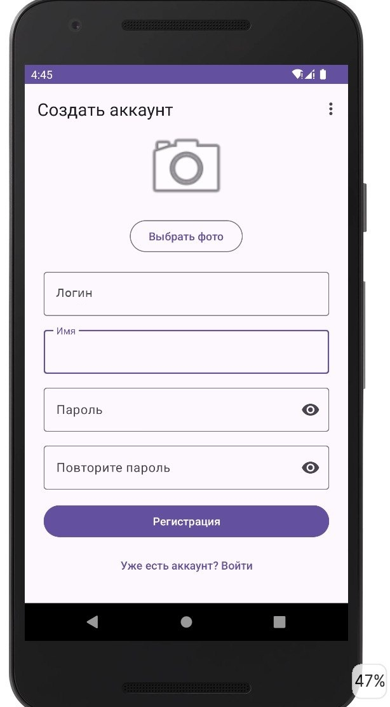
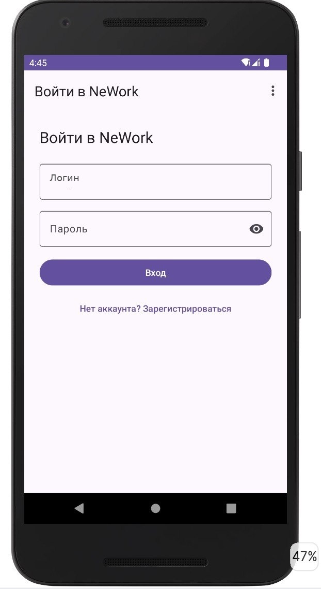

# NeWork

NeWork — мой учебный проект для Android. Это социальная сеть, где можно публиковать посты, создавать события и рассказывать о своём опыте работы.

## Возможности

Без входа можно смотреть посты, события и профили пользователей. После регистрации доступны лайки, создание публикаций, участие в событиях и управление своими местами работы.

Свои посты и события можно изменить через меню карточки или подробного экрана. В редакторе уже заполнены текст, ссылка, место на карте и другие поля. Вложение можно оставить, заменить или убрать.

В постах можно упоминать пользователей. У событий есть дата, формат — онлайн или офлайн — и список спикеров. Поддерживаются фото из камеры и галереи, аудио и видео до 15 МБ. На подробном экране видны участники или упоминания, последнее место работы автора и карта, если указана локация.

В профиле две вкладки: стена и работы. В своём профиле можно добавить, изменить и удалить место работы. Если дата окончания не указана, работа считается текущей.

## Скриншоты

| Регистрация | Вход |
| --- | --- |
|  |  |

## Как запустить

1. Откройте папку проекта в Android Studio.
2. Для сборки выберите JDK 17 в настройках Gradle. Проект использует Android Gradle Plugin 8.7.3 и Gradle 8.9. Android SDK Platform 35 устанавливается через SDK Manager.
3. Скопируйте файл `apikey.properties.example` в той же папке и назовите копию `apikey.properties`.
4. Вставьте свой учебный ключ после `api.key=`. Образец можно оставить.
5. Выполните синхронизацию Gradle и запустите приложение на телефоне или эмуляторе с Android 6.0 или выше.

Ключ выдаётся в личном кабинете курса. `apikey.properties` исключён из Git. Для входа в приложение нужно зарегистрировать свой аккаунт.

Приложение работает с учебным сервером `http://94.228.125.136:8080/`. [Описание API в Swagger](http://94.228.125.136:8080/swagger-ui/index.html).

## Проверка сборки

В терминале из папки проекта:

```bash
./gradlew assembleDebug testDebugUnitTest
```

Тесты проверяют сохранение ID при изменении записей, работу с вложениями, сохранение участников события, ошибки и повторную отправку, а также соответствие основных запросов API.

В репозитории есть GitHub Actions: после push выполняются сборка и тесты. Учебный API-ключ для этой проверки не нужен.

## Устройство проекта

Экраны написаны на XML с View Binding. В приложении одна Activity, переходами между фрагментами управляет Jetpack Navigation Component. Состояние экранов и обработка операций находятся во ViewModel.

- `ui/fragments` — экраны.
- `ui/viewmodel` — состояние и логика экранов.
- `ui/adapter` — адаптеры списков.
- `ui/utils` — работа с датами, изображениями, ссылками и картой.
- `domain` — модели, use case и интерфейс репозитория.
- `data` — Retrofit API, DTO, репозиторий и хранение авторизации.
- `di` — настройка зависимостей через Hilt.

Создание и изменение публикаций используют `POST /api/posts` и `POST /api/events`. Для работ используется `POST /api/my/jobs`. При изменении в теле запроса сохраняется ID существующей записи.

## Документация

- [Kotlin Coroutines](https://kotlinlang.org/docs/coroutines-overview.html)
- [Retrofit](https://square.github.io/retrofit/)
- [Dagger Hilt](https://dagger.dev/hilt/)
- [Navigation Component](https://developer.android.com/guide/navigation)
- [View Binding](https://developer.android.com/topic/libraries/view-binding)
- [MapLibre Android](https://maplibre.org/maplibre-native/android/api/)
- [Glide](https://bumptech.github.io/glide/)
- [Настройка JDK в Android Studio](https://developer.android.com/build/jdks)
- [Совместимость Android Gradle Plugin 8.7](https://developer.android.com/build/releases/agp-8-7-0-release-notes)

